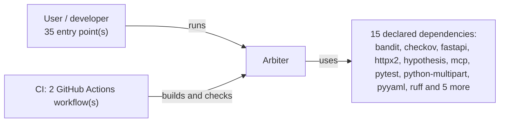
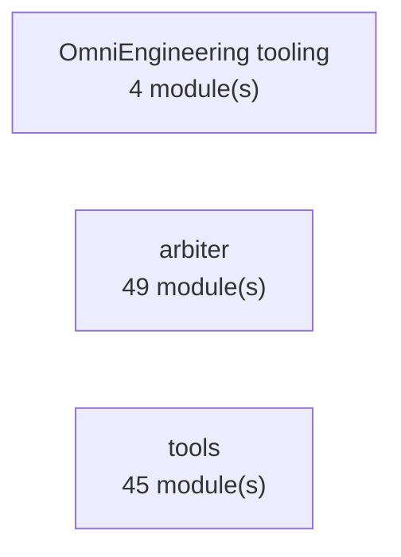
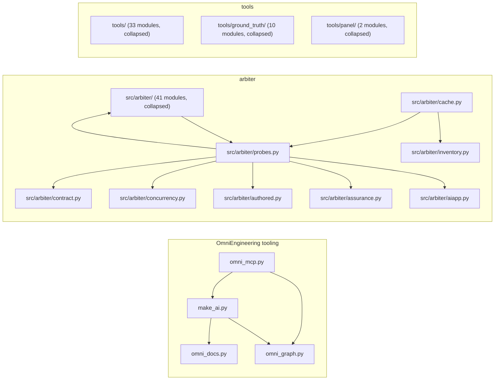
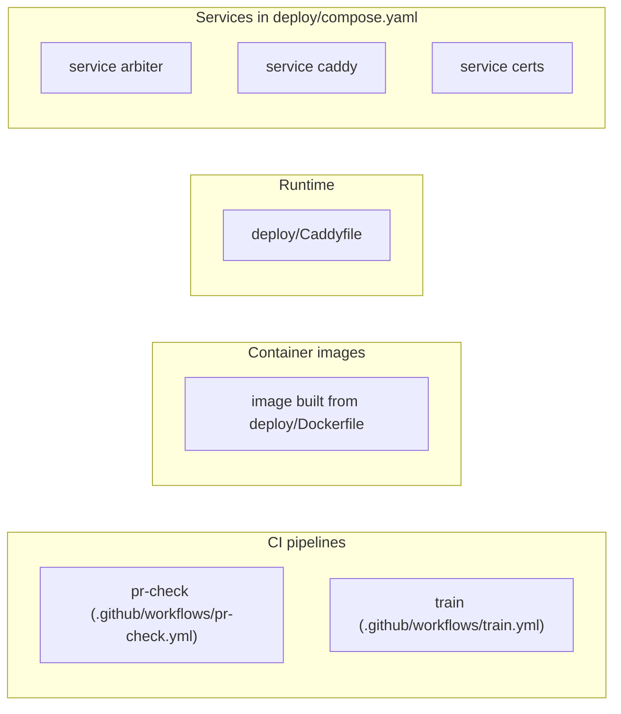

# Software Architecture Document (SAD)

<!-- Generated by `omni docs build` (REQ-060) for Arbiter. Do not edit; regenerate. -->

Structured after arc42 and ISO/IEC/IEEE 42010. Every view is derived from the code graph, the requirement registry, the failure ledger and files on disk; a view with no data behind it says so.

## 1. Introduction and goals

**System:** Arbiter

Arbiter scans one repository, or a **system** of several, and reports findings in seven dimensions: security, compliance, quality, drift, interface, supply chain and assurance. Next to the findings it reports how much of its own rubric it could run, names every check that did not run and why, and withholds the overall grade when that coverage is too low.

Open high-priority requirements (the current goals):

- ARB-005 (pending): Establish licensing terms for arbiter
- ARB-064 (pending): Every finding traceable in OmniGraph: rule, CWE, file, requirement, commit
- ARB-066 (proposed): Remediation through MCP, with a verify loop
- ARB-067 (proposed): Explain why a rule fired or did not fire; feed verdicts back into confidence
- ARB-069 (proposed): Claims need evidence: agent and PR claims carry the command that proves them
- ARB-071 (proposed): Briefs and instructions generated from code, or tested against it
- ARB-072 (proposed): Environment preflight before every agent or scan run
- ARB-097 (pending): Build a Python SQL injection oracle-conformance pilot
- ARB-101 (needs_review): Held-out set r5: 50 repositories frozen before scanning, 1,010 model labels
- ARB-110 (pending): Close recall gap without human reviewers: development-only recall analysis and preregistered model-labelled sample
- ... and 5 more; see the SRS.

## 2. Constraints

- Python >=3.10 (pyproject.toml `requires-python`).
- Languages in the code graph: bash (10 modules), python (190 modules).
- Project policy: `allow_broad_refactor`, `allow_dependency_changes`, `allow_schema_changes`, `allow_destructive_data_changes` are false, so such changes need explicit approval.
- Declared stack: Python >=3.11 (setuptools, src layout); runtime dependency PyYAML only; optional tree-sitter AST extra.

## 3. System context

- Actors and external systems come only from entry points, declared dependencies and CI files.

Entry points:

- console script `arbiter` -> arbiter.cli:main
- 34 runnable `__main__` scripts: 25 in `tools/`, 8 in `tools/ground_truth/`, 1 in `tools/panel/`

## 4. Building-block view

### 4.1 Containers (level 1)

- Edge labels count module-level imports between containers.

### 4.2 Components (level 2)

- 98 modules exceed the 16-node cap: the 12 most connected are shown; 41 in `src/arbiter`, 33 in `tools`, 10 in `tools/ground_truth`, 2 in `tools/panel` are collapsed into one node per package.
- Arrows point from the importing module to the imported one; labels count imports when more than one.
- 102 test module(s) are left out; see the test plan.

Per-module detail is in the [Software Design Document (SDD)](design.md) and the [Module Reference](modules.md).

## 5. Runtime view

**console script `arbiter` -> arbiter.cli:main**

```mermaid
flowchart TD
    f_src_arbiter_cli_py_main["main"]
    f_src_arbiter_cli_py_build_parser["build_parser"]
    f_src_arbiter_cli_py_cmd_ab["cmd_ab"]
    f_src_arbiter_cli_py_cmd_api["cmd_api"]
    f_src_arbiter_cli_py_cmd_baseline["cmd_baseline"]
    f_src_arbiter_cli_py_cmd_bundle["cmd_bundle"]
    f_src_arbiter_cli_py_cmd_controls["cmd_controls"]
    f_src_arbiter_cli_py_cmd_dashboard["cmd_dashboard"]
    f_src_arbiter_cli_py_cmd_diff["cmd_diff"]
    f_src_arbiter_cli_py_cmd_explain["cmd_explain"]
    f_src_arbiter_cli_py_cmd_feedback["cmd_feedback"]
    f_src_arbiter_cli_py_cmd_learn["cmd_learn"]
    f_src_arbiter_cli_py_cmd_probes["cmd_probes"]
    f_src_arbiter_cli_py_cmd_profile["cmd_profile"]
    f_src_arbiter_cli_py_main --> f_src_arbiter_cli_py_build_parser
    f_src_arbiter_cli_py_main --> f_src_arbiter_cli_py_cmd_ab
    f_src_arbiter_cli_py_main --> f_src_arbiter_cli_py_cmd_api
    f_src_arbiter_cli_py_main --> f_src_arbiter_cli_py_cmd_baseline
    f_src_arbiter_cli_py_main --> f_src_arbiter_cli_py_cmd_bundle
    f_src_arbiter_cli_py_main --> f_src_arbiter_cli_py_cmd_controls
    f_src_arbiter_cli_py_main --> f_src_arbiter_cli_py_cmd_dashboard
    f_src_arbiter_cli_py_main --> f_src_arbiter_cli_py_cmd_diff
    f_src_arbiter_cli_py_main --> f_src_arbiter_cli_py_cmd_explain
    f_src_arbiter_cli_py_main --> f_src_arbiter_cli_py_cmd_feedback
    f_src_arbiter_cli_py_main --> f_src_arbiter_cli_py_cmd_learn
    f_src_arbiter_cli_py_main --> f_src_arbiter_cli_py_cmd_probes
    f_src_arbiter_cli_py_main --> f_src_arbiter_cli_py_cmd_profile
```

- Static direct calls only (same-module, enclosing-class or import-resolved); call order and conditions are not shown.
- 18 further call(s) omitted at the 14-node cap.

## 6. Deployment view

- Nodes are grouped by descriptor type; how they connect at run time is not derived (no edges are drawn).

## 7. Cross-cutting concepts

External modules imported by three or more source modules: `pathlib` (73), `json` (61), `sys` (45), `re` (44), `` (36), `argparse` (36), `collections` (29), `dataclasses` (27), `typing` (27), `subprocess` (26), `os` (23), `time` (22), `arbiter` (15), `hashlib` (14), `random` (13).

Engineering rulepacks that apply across the codebase (`.ai/rules`):

- `completion-workflow`: Define the gates required before an AI-assisted task can be reported complete.
- `controlled-implementation`: Keep implementation work scoped, traceable, conservative, and maintainable.
- `data-governance`: Bound data-related work across contracts, validation, transformations, privacy, persistence, migrations, and testing.
- `fallback-llm-rules`: Structured form of .ai/entrypoints/fallback-contract.md's numbered rules, for a session that can only reach one rulepack file and needs the fallback rules machine-checkable rather than prose-only.
- `hci-ui-rules`: Keep interactive surfaces trustworthy for the person using them. Written against arbiter's own two review front ends (src/arbiter/review_ui.py: an offline single-file HTML page and a terminal front end, both adjudicating one finding at a time over the same ledger) rather than a generic UI checklist…
- `oop-design`: Keep domain modeling, module boundaries, interfaces, and dependency direction maintainable.

## 8. Architecture decisions

Decision records and design documents in the repository:

- [.ai/project-context.md](../../.ai/project-context.md): Project Context: arbiter
- [docs/architecture.md](../architecture.md): Architecture

## 9. Quality requirements

17 requirement(s) name a quality attribute in their category or title (accuracy 1, capability 2, compliance 1, measurement 1, performance 4, reliability 8); 7 still open: ARB-055, ARB-056, ARB-057, ARB-058, ARB-068, ARB-072, ARB-176. Each is a row in the [Software Requirements Specification (SRS)](requirements.md).

## 10. Risks and technical debt

0 open failure(s) of 98 in the failure ledger.

9 recorded failure(s) recurred after an earlier fix (technical debt that came back): FAIL-007 repeats FAIL-005, FAIL-010 repeats FAIL-009, FAIL-011 repeats FAIL-010, FAIL-027 repeats FAIL-023, FAIL-028 repeats FAIL-006, FAIL-033 repeats FAIL-007, FAIL-038 repeats FAIL-023, FAIL-039 repeats FAIL-036, FAIL-084 repeats FAIL-067.

Open requirements that carry risk notes, with the notes that fit on one line (`--detail full` writes them all):

- ARB-005 (pending): Requires qualified legal review and cannot be completed by engineering alone (more: `omni requirement show ARB-005`; 3 more notes)
- ARB-055 (proposed): Folded into ARB-061 (all-language interview slice), 2026-10-20
- ARB-056 (proposed): Folded into ARB-061 (all-language interview slice), 2026-10-20
- ARB-057 (proposed): Folded into ARB-061 (all-language interview slice), 2026-10-20
- ARB-058 (proposed): Folded into ARB-061 (all-language interview slice), 2026-10-20
- ARB-062 (pending): semgrep rules that fire on the fixed twin too (Ruby missing-csrf-protection, check-send-file and dangerous-exec, Flask ssrf-requests, bandit B603/B607) are not counted as coverage (more: `omni requirement show ARB-062`; 10 more notes)
- ARB-064 (pending): rule requirements 2026-10-22 (p1a-tiers): 157 of 228 shipped rules carry requirements: metadata (all 144 pack rules, 13 native); 71 predate the registry and are listed with that reason in tests/test_rule_requirements.py; findings carry requirements and reports a top-level rules block. (more: `omni requirement show ARB-064`)
- ARB-067 (proposed): 2026-10-22 progress (Phase 1 items 4-5): measured per-rule precision with no human labels: ground truth (OWASP Java/Python, Juliet Java, 70 CVE fix pairs; 8,061 labels) and two independent model labellers + adjudicator (692 labels, $34.82), in tools/gold/labels/ and tools/gold/results/2026-10-22-labels.md. (more: `omni requirement show ARB-067`; 5 more notes)
- ARB-068 (proposed): Automated edits can hide judgement; keep opt-in and reviewable.
- ARB-071 (proposed): progress 2026-10-23 (round 4 docs review): tests/test_docs.py checks that every relative link and #anchor in the root guides and docs/ resolves and that every CLI subcommand appears in docs/cli.md; a partial step toward criterion 2 (capability claims in docs/ tested), not the generated briefs of criterion 1
- ARB-097 (pending): No human reviewers are available so claims must remain benchmark-specific; Independent scanners and model judges are not ground truth (more: `omni requirement show ARB-097`; 3 more notes)
- ARB-101 (needs_review): Labels are model labels; not human labels. 993 tp / 12 fp / 5 unsure. Only supply.unpinned-action reaches Wilson lower >= 0.99 (0.9924 (more: `omni requirement show ARB-101`; 2 more notes)
- ARB-110 (pending): Model labels are not independent truth; Learned triage can overfit tuned corpora; Labeller cost and code leaving the machine as bounded excerpts only for public code
- ARB-153 (needs_review): Only the first repository's profile is consulted because quality thresholds are resolved once for the whole run; a multi-repo system scan cannot yet hold one set per repository (more: `omni requirement show ARB-153`; 3 more notes)
- ARB-162 (needs_review): Labelled 2026-10-26: 389 held-out findings, v3 prompts, $17.54. Census, so these are rates, not samples. (more: `omni requirement show ARB-162`)
- ARB-172 (pending): Detector dependence biases estimated totals downward; Small overlap counts can produce wide or unbounded intervals; CodeQL is unavailable and is not included as a detector

## 11. Glossary

Terms defined in code (public classes with a docstring):

| Term | Meaning | Defined in |
| --- | --- | --- |
| AdapterOutputError | The tool's output could not be read as the manifest says it should: nothing written, not JSON, or JSON without the key the findings live under. (more: `src/arbiter/adapters.py` docstring) | `src/arbiter/adapters.py` |
| AnalyzerErrors | The tool reported errors of its own (`map.errors`, bandit's and semgrep's `errors[]`): files it could not parse, rules it could not load. (more: `src/arbiter/adapters.py` docstring) | `src/arbiter/adapters.py` |
| AuditLog | One JSON line per request: who called, what they asked, how it ended. | `src/arbiter/api.py` |
| AV | An abstract value. (more: `src/arbiter/dataflow.py` docstring) | `src/arbiter/dataflow.py` |
| Budget | The per-file step budget ran out. | `src/arbiter/dataflow.py` |
| Budget | A spend cap across parallel runs. (more: `tools/ai_corpus_generate.py` docstring) | `tools/ai_corpus_generate.py` |
| BundleError | A bundle could not be built or read. The message says why. | `src/arbiter/bundle.py` |
| Cache | Append-only JSONL: one line per answered call. | `tools/label_models.py` |
| ClientError | Something the caller can act on: a bad address, a refused key, a cap. | `src/arbiter/client.py` |
| EvaluationError | Invalid or incomplete benchmark evaluation input. | `tools/ground_truth/realvuln_conformance.py` |
| FakeProvider | A scripted seat for tests: `answers(prompt) -> reply text` (or an exception to raise). No process is started. | `tools/panel/providers.py` |
| FileRateLimiter | The same caps as `RateLimiter`, counted in SQLite so that every process serving the same keys shares one budget. | `src/arbiter/api.py` |
| GeminiProvider | Google's Gemini CLI in headless mode (`-p`, `--output-format stream-json`). (more: `tools/panel/providers.py` docstring) | `tools/panel/providers.py` |
| PackError | A pack that does not match the schema above. Raised at load time so a broken pack fails the test suite instead of silently checking nothing. | `src/arbiter/lang_rules.py` |
| ParseError | The model did not answer in the required JSON shape. | `tools/panel/providers.py` |
| ProbeOutcome | Why a probe did or did not contribute. Absence of findings is only a pass when status == 'ran'. | `src/arbiter/core.py` |
| Provider | One way to ask a model a question. Adding a vendor is a subclass. | `src/arbiter/judgement.py` |
| Provider | One panel seat. Subclasses implement `_available` and `_call`. | `tools/panel/providers.py` |
| ProviderError | A call failed; the item is left unlabelled by this seat. | `tools/panel/providers.py` |
| RateLimited | A key asked for too much. Carries how long to wait. | `src/arbiter/api.py` |

19 more documented classes are documented in the source (`--detail full` lists them in the SDD).
