# Class Diagram

<!-- Generated by `omni docs build` (REQ-060) for Arbiter. Do not edit; regenerate. -->

91 class(es) in the code graph; per-package diagrams are in the [Software Design Document (SDD)](design.md).

```mermaid
classDiagram
    class C_src_arbiter_adapters_py_Adapter["Adapter"] {
        +missing_binaries(ctx)
        +missing_files(ctx)
        +tool_version()
        +invoke(workdir)
        +parse_output(out)
        +decode(out)
        +rows_of(doc)
        +reported_errors(doc)
        +to_findings(rows, repo_id, workdir)
        +run(ctx)
    }
    class C_src_arbiter_adapters_py_AdapterOutputError["AdapterOutputError"] {
    }
    class C_src_arbiter_adapters_py_AnalyzerErrors["AnalyzerErrors"] {
    }
    class C_src_arbiter_api_py_RateLimited["RateLimited"] {
    }
    class C_src_arbiter_core_py_Finding["Finding"] {
        +fingerprint_base()
        +fingerprint()
        +weight()
        +to_dict()
        +from_dict(d)
    }
    class C_src_arbiter_core_py_Location["Location"] {
        +to_dict()
        +short()
    }
    class C_src_arbiter_core_py_Report["Report"] {
        +active()
        +to_dict()
        +from_dict(d)
    }
    class C_src_arbiter_dataflow_py_Budget["Budget"] {
    }
    class C_src_arbiter_dataflow_py_Interp["Interp"] {
        +func_name(fn)
        +tick()
        +note(node, av)
        +params(fn)
        +body(fn)
        +enter_env(fn, args, kwargs)
        +run_function(fn, args, kwargs)
        +call_same_file(call, name, args, kwargs, receiver_ok)
        +exec_body(node, env, returns)
        +exec(node, env, returns)
        +run_nested(fn, env)
        +join_env(a, b)
    }
    class C_src_arbiter_judgement_py_AnthropicProvider["AnthropicProvider"] {
        +available()
        +complete(system, user)
    }
    class C_src_arbiter_judgement_py_Provider["Provider"] {
        +available()
        +complete(system, user)
    }
    class C_src_arbiter_judgement_py_Unavailable["Unavailable"] {
    }
    class C_src_arbiter_service_py_ServiceError["ServiceError"] {
    }
    class C_src_arbiter_verify_py_VerifyProvider["VerifyProvider"] {
        +body(system, user)
        +ask(system, user)
        +complete(system, user)
    }
    class C_tools_panel_providers_py_ClaudeProvider["ClaudeProvider"] {
        +labeller()
        +vendor()
    }
    class C_tools_panel_providers_py_CodexProvider["CodexProvider"] {
        +command(schema, out, cwd)
    }
    class C_tools_panel_providers_py_CopilotProvider["CopilotProvider"] {
        +command(prompt, model, cwd)
    }
    class C_tools_panel_providers_py_FakeProvider["FakeProvider"] {
    }
    class C_tools_panel_providers_py_GeminiProvider["GeminiProvider"] {
        +vendor()
        +labeller()
        +command(policy)
    }
    class C_tools_panel_providers_py_ParseError["ParseError"] {
    }
    class C_tools_panel_providers_py_Provider["Provider"] {
        +vendor()
        +labeller()
        +available()
        +label(system, prompt)
        +classify(msg)
    }
    class C_tools_panel_providers_py_ProviderError["ProviderError"] {
    }
    class C_tools_panel_providers_py_Unavailable["Unavailable"] {
    }
    class C_tools_panel_providers_py_UsageLimit["UsageLimit"] {
    }
    class C_tools_panel_providers_py_VendorConflict["VendorConflict"] {
    }
    C_src_arbiter_service_py_ServiceError <|-- C_src_arbiter_api_py_RateLimited
    C_src_arbiter_judgement_py_Provider <|-- C_src_arbiter_judgement_py_AnthropicProvider
    C_src_arbiter_judgement_py_AnthropicProvider <|-- C_src_arbiter_verify_py_VerifyProvider
    C_tools_panel_providers_py_Provider <|-- C_tools_panel_providers_py_ClaudeProvider
    C_tools_panel_providers_py_Provider <|-- C_tools_panel_providers_py_CodexProvider
    C_tools_panel_providers_py_Provider <|-- C_tools_panel_providers_py_CopilotProvider
    C_tools_panel_providers_py_Provider <|-- C_tools_panel_providers_py_FakeProvider
    C_tools_panel_providers_py_Provider <|-- C_tools_panel_providers_py_GeminiProvider
    C_tools_panel_providers_py_ProviderError <|-- C_tools_panel_providers_py_ParseError
    C_tools_panel_providers_py_ProviderError <|-- C_tools_panel_providers_py_Unavailable
    C_tools_panel_providers_py_ProviderError <|-- C_tools_panel_providers_py_UsageLimit
    C_tools_panel_providers_py_ProviderError <|-- C_tools_panel_providers_py_VendorConflict
    class C_ext_RuntimeError["RuntimeError"]
    <<external>> C_ext_RuntimeError
    C_ext_RuntimeError <|-- C_src_arbiter_adapters_py_AdapterOutputError
    C_ext_RuntimeError <|-- C_src_arbiter_adapters_py_AnalyzerErrors
    class C_ext_ServiceError["ServiceError"]
    <<external>> C_ext_ServiceError
    C_ext_ServiceError <|-- C_src_arbiter_api_py_RateLimited
    class C_ext_Exception["Exception"]
    <<external>> C_ext_Exception
    C_ext_Exception <|-- C_src_arbiter_dataflow_py_Budget
    class C_ext_Provider["Provider"]
    <<external>> C_ext_Provider
    C_ext_Provider <|-- C_src_arbiter_judgement_py_AnthropicProvider
    C_ext_RuntimeError <|-- C_src_arbiter_judgement_py_Unavailable
    C_ext_RuntimeError <|-- C_src_arbiter_service_py_ServiceError
    class C_ext_AnthropicProvider["AnthropicProvider"]
    <<external>> C_ext_AnthropicProvider
    C_ext_AnthropicProvider <|-- C_src_arbiter_verify_py_VerifyProvider
    C_ext_Provider <|-- C_tools_panel_providers_py_ClaudeProvider
    C_ext_Provider <|-- C_tools_panel_providers_py_CodexProvider
    C_ext_Provider <|-- C_tools_panel_providers_py_CopilotProvider
    C_ext_Provider <|-- C_tools_panel_providers_py_FakeProvider
    C_ext_Provider <|-- C_tools_panel_providers_py_GeminiProvider
    class C_ext_ProviderError["ProviderError"]
    <<external>> C_ext_ProviderError
    C_ext_ProviderError <|-- C_tools_panel_providers_py_ParseError
    C_ext_RuntimeError <|-- C_tools_panel_providers_py_ProviderError
    C_ext_ProviderError <|-- C_tools_panel_providers_py_Unavailable
    C_ext_ProviderError <|-- C_tools_panel_providers_py_UsageLimit
    C_ext_ProviderError <|-- C_tools_panel_providers_py_VendorConflict
    C_src_arbiter_adapters_py_Adapter ..> C_src_arbiter_adapters_py_AdapterOutputError : creates
    C_src_arbiter_adapters_py_Adapter ..> C_src_arbiter_adapters_py_AnalyzerErrors : creates
    C_src_arbiter_adapters_py_Adapter ..> C_src_arbiter_core_py_Finding : creates
    C_src_arbiter_adapters_py_Adapter ..> C_src_arbiter_core_py_Location : creates
    C_src_arbiter_core_py_Finding ..> C_src_arbiter_core_py_Location : creates
    C_src_arbiter_dataflow_py_Interp ..> C_src_arbiter_dataflow_py_Budget : creates
    C_src_arbiter_judgement_py_AnthropicProvider ..> C_src_arbiter_judgement_py_Unavailable : creates
    C_src_arbiter_judgement_py_Provider ..> C_src_arbiter_judgement_py_Unavailable : creates
    C_tools_panel_providers_py_CodexProvider ..> C_tools_panel_providers_py_ProviderError : creates
    C_tools_panel_providers_py_CopilotProvider ..> C_tools_panel_providers_py_ProviderError : creates
    C_tools_panel_providers_py_CopilotProvider ..> C_tools_panel_providers_py_Unavailable : creates
    C_tools_panel_providers_py_CopilotProvider ..> C_tools_panel_providers_py_VendorConflict : creates
    C_tools_panel_providers_py_GeminiProvider ..> C_tools_panel_providers_py_ProviderError : creates
    C_tools_panel_providers_py_GeminiProvider ..> C_tools_panel_providers_py_Unavailable : creates
    C_tools_panel_providers_py_GeminiProvider ..> C_tools_panel_providers_py_VendorConflict : creates
    C_tools_panel_providers_py_Provider ..> C_tools_panel_providers_py_ParseError : creates
    C_tools_panel_providers_py_Provider ..> C_tools_panel_providers_py_ProviderError : creates
    C_tools_panel_providers_py_Provider ..> C_tools_panel_providers_py_Unavailable : creates
    C_tools_panel_providers_py_Provider ..> C_tools_panel_providers_py_UsageLimit : creates
    C_tools_panel_providers_py_Provider ..> C_tools_panel_providers_py_VendorConflict : creates
```

- 91 classes exceed the 25-class cap; the 25 with the most relations are shown.
- `<|--` is inheritance; `..> creates` means a method of the first class instantiates the second (resolved call edge). Attribute composition is not in the graph and is not drawn.
